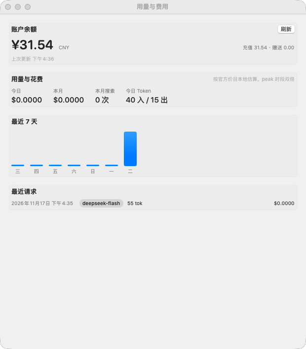

# DeepmacOS

macOS 原生壳 + 官方开源聊天前端 + DeepSeek 官方 API 的第三方客户端。

- 界面：官方开源的 [deepseek-ai/chat-demo](https://github.com/deepseek-ai/chat-demo)（MIT），构建产物原样内嵌，不改界面行为
- 壳：SwiftUI / AppKit + WKWebView，本地回环静态服务，无 Electron、无自建后端
- 模型：`deepseek-flash`（1M 上下文，支持图片输入）
- 数据：全部保存在本机；不上传除 API 调用所需内容以外的任何数据

> 与 DeepSeek 官方无隶属关系，不包含官方商标与图标；使用你自己的 API Key，按官方价目计费。

## 功能

对话能力来自官方前端，与网页版对齐：

- 多会话、自动标题、重命名/删除、编辑提问、重新生成、消息分支
- 流式回复、深度思考、联网搜索与来源引用、链接阅读
- 附件上传/粘贴/拖拽、图片理解、OCR（服务端解析）
- 语音输入（ASR）、朗读（TTS）
- Markdown、代码高亮、KaTeX、Mermaid
- 历史导入导出（ZIP）

原生壳提供：

- 菜单与快捷键：⌘N 新建对话、⌘R 重载、⌘F 查找、⌘, 设置、⌘⇧U 用量与费用、⌘± / ⌘0 缩放
- 外链走系统浏览器；导出 ZIP 走系统"另存为"；文件拖拽上传
- 回复完成通知（窗口不在前台时）与 Dock 角标
- 窗口位置/尺寸恢复、单实例
- **用量看板 + 余额**：按官方价目本地估算花费，`GET /user/balance` 显示余额，低余额提醒（默认阈值 10，可改）
- **增强功能默认全部关闭**：全局快捷键（⌥Space）、Services 服务、菜单栏常驻，都需要在「设置 → 通用 → 增强功能」里显式打开



## 使用

### 安装

挂载 `DeepMacOS.dmg`，把 `DeepmacOS.app` 拖进"应用程序"。首次打开若被 Gatekeeper 拦截（本地 ad-hoc 签名），在"系统设置 → 隐私与安全性"里点"仍要打开"。

### 首次配置

1. 打开应用，界面里点「设置」→ 填入 API Key（官方平台申请）
2. 想用语音输入时，允许麦克风权限（WKWebView 通过原生授权回调放行）
3. 需要通知时，应用首次激活后会请求通知权限；拒绝也不影响使用

### 数据位置

| 内容 | 位置 |
| --- | --- |
| 会话与附件（IndexedDB） | `~/Library/WebKit/com.deepmacos.app/WebsiteData/` |
| 用量账本（JSONL） | `~/Library/Application Support/DeepmacOS/usage.jsonl` |
| 偏好（端口、阈值、开关） | `defaults read com.deepmacos.app` |

> 本地服务端口固定（默认 43110，被占用时顺延）。端口不能每次变，否则浏览器 origin 变化会看不到历史；该端口会写回偏好，请勿手动改。

## 构建

需要 macOS 14+、Xcode 命令行工具、Node 22+。

```bash
make web    # 拉取并构建官方前端到 web/
make app    # 编译并组装 dist/DeepmacOS.app（ad-hoc 签名）
make dmg    # 生成 dist/DeepMacOS.dmg
make run    # 开发模式直接跑（DEEPMACOS_WEB_ROOT 指向 web/）
```

前端来源固定在 `vendor/chat-demo` 的 commit `5d5dd75`，另加一个最小补丁（`src/services/api/native.ts` + `client.ts` 的用量上报），用于把每轮 `usage` 交给原生账本。

## 自检（可选）

设置环境变量 `DEEPMACOS_SELFTEST=1` 启动后，菜单栏会多一个「自检」：

- 页面探针：输出 origin、Key 是否存在、IndexedDB 会话数
- 写入 API Key（env）：从 `DEEPMACOS_SELFTEST_KEY` 写入 localStorage
- 发送测试消息、合成用量事件、触发 blob 下载（配合 `DEEPMACOS_SELFTEST_DOWNLOAD_DIR` 自动落盘）

这些入口不设置环境变量时不出现。

## 已知限制

- API Key 目前由官方前端保存在 WebView 的 localStorage（与网页版一致），尚未迁到钥匙串；依赖 FileVault 与只在本机使用
- 无云端同步、无分享链接：官方 API 没有对应端点，需要自建后端
- 不能上架 Mac App Store；对公分发需要 Developer ID + 公证（$99/年）
- 通知只做"回复完成"和"低余额"，语音与搜索未单独提醒
- 应用内「查找」是简化实现（`window.find`），不是完整查找替换

## 许可

界面代码来自 chat-demo，MIT；分发时随包附带 `LICENSE`。本应用的壳代码同样以 MIT 提供。
